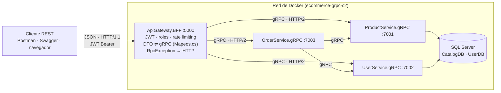

# ECommerceGRPC · Tarea 1 · Arquitectura híbrida REST/gRPC con JWT

Microservicios Resilientes con .NET Core y AWS (Nivel 2) · CPIC · 2026

El gateway **ApiGateway.BFF** recibe JSON por REST (HTTP/1.1) y responde llamando por gRPC (HTTP/2) a los servicios internos. En esta tarea se le agregaron **tres endpoints REST nuevos** que responden desde dos servicios gRPC que ya existían, sin cambiar ningún `.proto` ni ningún servicio gRPC.

## Integrantes del grupo

| Nombre | Usuario de GitHub |
|---|---|
| Eliecer Marenco | [alessio034](https://github.com/alessio034) |

Trabajo individual.

## Arquitectura



Versión en texto:

```
Cliente REST ──JSON/HTTP 1.1──▶ ApiGateway.BFF :5000 ──gRPC/HTTP 2──▶ ProductService.gRPC :7001 ──▶ CatalogDB
  (Postman,                     (JWT, roles,          ──gRPC/HTTP 2──▶ UserService.gRPC    :7002 ──▶ UserDB
   Swagger)                      rate limiting,       ──gRPC/HTTP 2──▶ OrderService.gRPC   :7003 ──▶ (Productos + Usuarios)
                                 DTO ⇄ mensaje gRPC)
```

| Pieza | Dónde está |
|---|---|
| DTO de solicitud y respuesta (lo que ve el cliente) | `ApiGateway.BFF/Modelos/Dtos.cs` |
| Transformación DTO ⇄ mensaje gRPC (ningún controlador arma mensajes a mano) | `ApiGateway.BFF/Modelos/Mapeos.cs` |
| Clientes gRPC registrados por inyección de dependencias | `ApiGateway.BFF/Program.cs` (`AddGrpcClient`) |
| Traducción de errores gRPC → HTTP | `ApiGateway.BFF/Errores/RpcExceptionHandler.cs` |
| Políticas de rate limiting | `ApiGateway.BFF/Program.cs` (`AddRateLimiter`) |

## Cómo levantar el sistema

Requisitos: Docker Desktop, PowerShell 7 y, para la colección, Postman (o `npx newman`).

```powershell
# Si hay otro kit del curso encendido, apáguelo primero (comparten los puertos):
docker compose -p ecommerce-grpc down

cd Infrastructure
docker compose up -d --build
docker compose ps        # siete servicios en Up
```

- Swagger: <http://localhost:5000/swagger>
- Apagar: `docker compose down` (los datos se conservan).

| Servicio | Afuera (su máquina) | Adentro (red de Docker) |
|---|---|---|
| Gateway REST + Swagger | `localhost:5000` | `gateway:5000` |
| ProductService.gRPC | `localhost:7001` | `product-grpc:7001` |
| UserService.gRPC | `localhost:7002` | `user-grpc:7002` |
| OrderService.gRPC | `localhost:7003` | `order-grpc:7003` |
| Catálogo REST (Nivel 1) | `localhost:5001` | `catalog-service:8080` |
| Usuarios REST (Nivel 1) | `localhost:5002` | `user-service:8080` |
| SQL Server | `localhost,1434` | `sqlserver,1433` |

## Usuarios de prueba

| Correo | Clave | Rol |
|---|---|---|
| `admin@example.com` | `Admin2026!` | Admin |
| `user@example.com` | `Cliente2026!` | Cliente |

Inicio de sesión: `POST /api/auth/login` con `{"email": "...", "clave": "..."}`. La respuesta trae `token`. En Swagger se pega en **Authorize** sin la palabra `Bearer`.

> Las claves de demostración y la clave de firma del JWT de `appsettings.json` son solo de desarrollo, como venían en el código base del curso. En producción van en variables de entorno o en un gestor de secretos.

## Los tres endpoints nuevos

| # | Endpoint | Llama a (gRPC) | Quién puede | Rate limiting | Respuestas |
|---|---|---|---|---|---|
| 1 | `POST /api/v1/productos` | `ProductService.CreateProduct` | Rol Admin | `escrituras`: 3 por usuario cada 30 s | 201 · 400 · 401 · 403 · 409 · 429 |
| 2 | `POST /api/v1/usuarios/registro` | `UserService.CreateUser` | Cualquiera, sin token | `registro`: 5 por IP cada minuto | 201 · 400 · 409 · 429 |
| 3 | `GET /api/v1/usuarios` | `UserService.ListUsers` (server streaming) | Rol Admin | `lecturas`: 10 por IP cada 10 s | 200 · 401 · 403 · 429 |

Los 201 se responden con `CreatedAtAction`: el encabezado `Location` apunta al GET por id que ya existía.

### 1 · Crear producto (Admin)

```http
POST /api/v1/productos
Authorization: Bearer <token de Admin>
Content-Type: application/json

{
  "nombre": "Teclado mecánico",
  "descripcion": "Switches rojos",
  "precio": 129.99,
  "stock": 15,
  "categoria": "Accesorios"
}
```

```http
HTTP/1.1 201 Created
Location: http://localhost:5000/api/v1/productos/4

{
  "id": 4,
  "nombre": "Teclado mecánico",
  "descripcion": "Switches rojos",
  "precio": 129.99,
  "categoria": "Accesorios",
  "stock": 15,
  "disponible": true
}
```

El precio llega como `decimal` y viaja a gRPC como `double` (proto3 no tiene decimal). Errores:

| Caso | Respuesta |
|---|---|
| Nombre vacío, precio ≤ 0 o stock negativo | `400` con el detalle de cada campo |
| Sin token | `401` |
| Token de Cliente | `403` |
| Ya existe un producto con ese nombre | `409` (`AlreadyExists` de gRPC) |
| Cuarta escritura del mismo usuario en 30 s | `429` con encabezado `Retry-After` |

```json
{
  "title": "La solicitud no se pudo completar.",
  "status": 409,
  "detail": "Ya existe un producto llamado 'Teclado mecánico'.",
  "codigoGrpc": "AlreadyExists"
}
```

### 2 · Registro de usuario (sin token)

```http
POST /api/v1/usuarios/registro
Content-Type: application/json

{
  "email": "ana@example.com",
  "nombre": "Ana",
  "apellido": "Pérez",
  "clave": "Clave2026!"
}
```

```http
HTTP/1.1 201 Created
Location: http://localhost:5000/api/v1/usuarios/3

{
  "id": 3,
  "email": "ana@example.com",
  "nombreCompleto": "Ana Pérez",
  "activo": true,
  "creadoEl": "2026-11-12T14:30:00Z"
}
```

La clave nunca se devuelve: UserService.gRPC la guarda con BCrypt. Errores: `400` si el correo no es válido, si falta el nombre o el apellido, o si la clave tiene menos de 8 caracteres. `409` si el correo ya está registrado.

### 3 · Listar usuarios (Admin)

```http
GET /api/v1/usuarios
Authorization: Bearer <token de Admin>
```

```json
[
  { "id": 1, "email": "admin@example.com", "nombreCompleto": "Admin System", "activo": true, "creadoEl": "2026-09-14T00:00:00Z" },
  { "id": 2, "email": "user@example.com",  "nombreCompleto": "John Doe", "activo": true, "creadoEl": "2026-09-14T00:00:00Z" }
]
```

Por dentro es **server streaming**: UserService.gRPC envía un mensaje por usuario activo y el gateway los junta en una lista JSON. Errores: `401` sin token y `403` con token de Cliente.

## Colección de Postman

`Postman/ECommerceGRPC_Clase2.postman_collection.json`, con el entorno `Postman/ECommerceGRPC_Clase2.postman_environment.json`.

- Corra la colección completa en orden (**Run collection**): la carpeta **0** guarda los tokens que usan las demás.
- La carpeta **«6 · Tarea 1»** tiene una prueba (`pm.test`) por cada respuesta de la tabla, más la del `429` con `Retry-After`.
- Tarda unos 35 s: antes de la cuarta escritura de Admin espera 31 s (`setTimeout`) para que se libere la política `escrituras`.
- Al terminar, espere 30 s antes de correrla otra vez, porque la última prueba deja agotada esa política.

Desde la consola:

```powershell
cd Postman
npx newman run ECommerceGRPC_Clase2.postman_collection.json
```

Resultado verificado: **32 solicitudes, 48 pruebas, 0 fallas.**

## Resiliencia: un servicio interno caído

```powershell
cd Infrastructure
docker compose stop order-grpc
# POST /api/v1/pedidos/validar  →  503 Service Unavailable
# GET  /api/v1/productos/1      →  200 (el gateway sigue atendiendo)
# GET  /api/v1/usuarios         →  200
docker compose start order-grpc
# a los pocos segundos, POST /api/v1/pedidos/validar vuelve a responder 200
```

La respuesta 503 sale de `RpcExceptionHandler` (`Unavailable` de gRPC → HTTP 503):

```json
{
  "title": "Un servicio interno no responde.",
  "status": 503,
  "detail": "Error connecting to subchannel.",
  "codigoGrpc": "Unavailable"
}
```

## Autoverificación de la práctica de la clase

```powershell
.\Probar-Gateway.ps1     # Resultado: PASA 8/8
```
